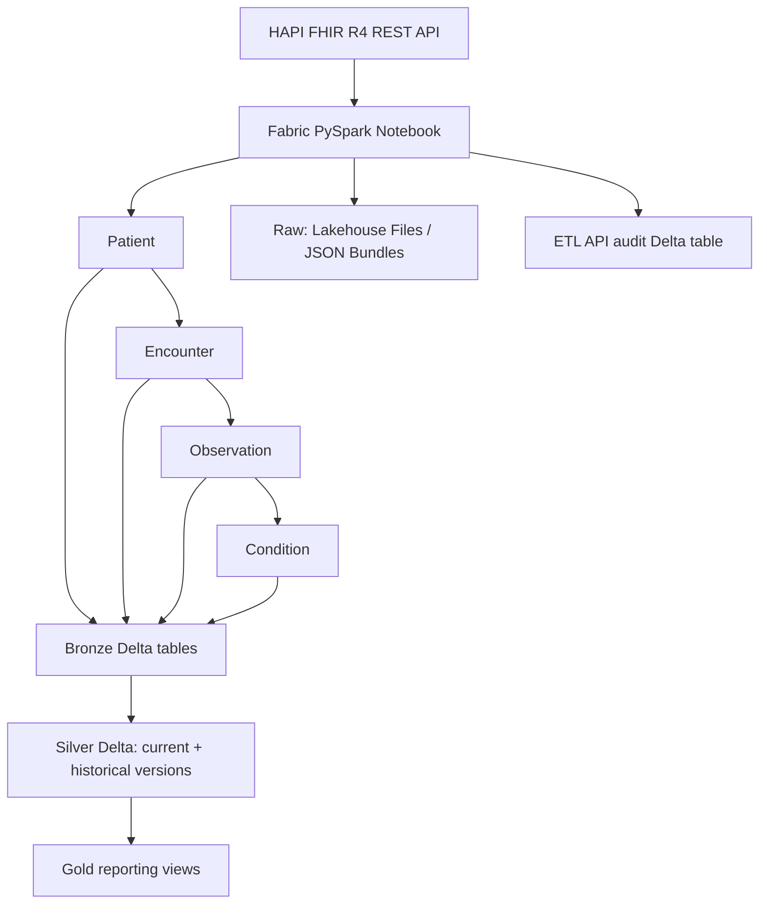

# FHIR R4 Ingestion & Medallion Architecture on Microsoft Fabric

A Microsoft Fabric data-engineering assignment demonstrating incremental ingestion from a FHIR R4 REST API, raw JSON landing, Bronze/Silver/Gold processing with Delta Lake, SCD Type 2 versioning, and run-level audit logging.

> **Implementation status:** Successfully executed in a Microsoft Fabric notebook against the public HAPI FHIR R4 test endpoint. The execution evidence and validation results below are from the Fabric runs captured on **25 November 2026**. The SCD Type 2 change test uses synthetic data in isolated test tables; it does not modify the API-derived Patient tables.

## Contents

- [Project objective](#project-objective)
- [Architecture](#architecture)
- [Technology stack](#technology-stack)
- [FHIR resources and extraction](#fhir-resources-and-extraction)
- [Medallion layers](#medallion-layers)
- [SCD Type 2 strategy and test evidence](#scd-type-2-strategy-and-test-evidence)
- [Audit and observability](#audit-and-observability)
- [Fabric deployment](#fabric-deployment)
- [Validation results](#validation-results)
- [Repository structure](#repository-structure)
- [Limitations and production hardening](#limitations-and-production-hardening)

## Project objective

Build an incremental FHIR R4 ingestion and analytics pipeline in Microsoft Fabric. The pipeline retrieves four resource types in a defined order, preserves original API Bundle responses, writes resource-level Delta tables, maintains current and historical resource versions in Silver, exposes Gold reporting views, and records execution metadata in an audit table.

The configured extraction lookback is **three days (a rolling 72-hour UTC window)**. The pipeline follows the FHIR server's pagination links rather than calculating page offsets itself.

## Architecture



### Processing sequence

1. Generate a unique pipeline run ID and calculate the UTC extraction window.
2. Call the FHIR API for `Patient`, `Encounter`, `Observation`, and `Condition`, in that order.
3. Follow each Bundle `link` entry with `relation = next` until pagination is complete.
4. Save each original Bundle response as a JSON file in the Lakehouse Files area.
5. Extract matching resources and append resource-version rows to Bronze Delta tables.
6. Apply Silver transformations and SCD Type 2 processing.
7. Create/refresh Gold views for current records.
8. Write one audit record per resource type, including timestamps, page/record counts, status, and error details.

## Technology stack

- Microsoft Fabric Lakehouse and Spark notebook
- PySpark / Spark SQL
- Delta Lake (`delta.tables.DeltaTable`)
- Python 3.10+
- `requests` and `urllib3` for HTTP access and retry handling
- Git and GitHub for source control

## FHIR resources and extraction

| Order | FHIR resource | Bronze table | Silver table |
|---:|---|---|---|
| 1 | Patient | `bronze_fhir_patient` | `silver_fhir_patient` |
| 2 | Encounter | `bronze_fhir_encounter` | `silver_fhir_encounter` |
| 3 | Observation | `bronze_fhir_observation` | `silver_fhir_observation` |
| 4 | Condition | `bronze_fhir_condition` | `silver_fhir_condition` |

Default endpoint: `https://hapi.fhir.org/baseR4`

Default parameters:

```python
lookback_days = 3
page_size = 100
base_url = "https://hapi.fhir.org/baseR4"
```

The API search uses `_lastUpdated` with a lower and upper bound for the rolling three-day window. The server-provided `next` URL is followed for pagination. The client applies finite request timeouts, retries transient HTTP failures, and checks that pagination links remain on the configured HTTPS host.

## Medallion layers

### Raw

Original FHIR Bundle JSON is stored in Lakehouse Files, partitioned by resource, extraction date, and run ID. Raw payloads are preserved before parsing so that the source response can be inspected independently of downstream transformations.

Example path pattern:

```text
Files/raw/fhir/<Resource>/YYYY/MM/DD/run_id=<run-id>/page_00001.json
```

### Bronze

Append-oriented Delta tables contain one row per extracted resource observation/version. The resource JSON is retained as canonicalized JSON, with metadata including:

- `resource_type`
- `resource_id`
- `last_updated`
- `resource_json`
- `resource_hash` (SHA-256)
- `extraction_timestamp`
- `api_url_or_params`
- `source_file`
- `ingestion_run_id`

Overlapping incremental windows can result in repeated observations in Bronze. Silver is responsible for resolving the latest resource version and maintaining current/history state.

### Silver

Silver tables retain the full `resource_json` and expose common queryable attributes such as status, patient/subject reference, encounter reference, effective date/time, resource hash, and SCD2 validity columns.

SCD2 columns include:

- `is_current`
- `valid_from`
- `valid_to`
- `created_at`
- `updated_at`

When an incoming resource has the same ID but a changed hash, the prior current version is closed and a new current version is inserted. An unchanged resource should not create an additional Silver version.

### Gold

The following current-state views were created and validated:

- `gold_patient`
- `gold_encounter`
- `gold_observation`
- `gold_condition`
- `gold_observation_reporting`

The views expose current resource records for downstream reporting. The reporting view provides Observation-focused fields such as patient reference, encounter reference, code text, value, unit, and effective date/time.

## SCD Type 2 strategy and test evidence

SCD Type 2 behaviour was tested in isolated Delta tables using a synthetic Patient resource with ID `P001`. The test deliberately used the same resource ID and changed the resource content from `gender = male` to `gender = female`.

Test table names:

```text
scd2_test_bronze_patient
scd2_test_silver_patient
```

Test sequence:

1. Insert the initial synthetic Patient version (`male`).
2. Re-ingest the same unchanged resource to test idempotency.
3. Ingest the same resource ID with changed content (`female`).
4. Assert the historical and current version state.

**Observed final validation output:**

| Assertion | Observed result |
|---|---:|
| Total versions | 2 |
| Current versions | 1 |
| Historical versions | 1 |
| Closed historical versions | 1 |
| Open current versions | 1 |
| Duplicate current records | 0 |
| Distinct resource hashes | 2 |

All seven SCD2 assertions passed in the Fabric notebook.

**Scope clarification:** This proves the SCD2 transformation path using controlled synthetic input. The public API extraction runs did not demonstrate an actual changed live FHIR resource transitioning through SCD2. The synthetic test tables are separate from the API-derived Silver tables.

## Audit and observability

The Delta audit table is `etl_api_audit`. It records one row per resource per pipeline run, including:

- `ingestion_run_id`
- `resource_type`
- `api_call_started_at`
- `api_call_completed_at`
- `data_saved_at`
- `request_window_start`
- `request_window_end`
- `pages_fetched`
- `records_fetched`
- `status`
- `error_message`

Resource-level failures are logged and audited. The orchestrator continues with the remaining configured resource types, then raises a pipeline-level exception if any resource failed so that the Fabric notebook activity is marked as failed.

## Fabric deployment

### Prerequisites

- A Microsoft Fabric workspace with permission to create and run Lakehouses and notebooks.
- Fabric capacity or trial capacity that supports Spark execution.
- A Lakehouse attached to the notebook as its default Lakehouse.
- Access to the public HAPI FHIR endpoint from the Fabric environment.

### 1. Create and attach the Lakehouse

Create a Lakehouse named `FHIR_Lakehouse` in the target workspace. Attach it to the notebook as the default Lakehouse.

### 2. Upload the Python package

Upload the contents of `src/fhir_fabric/` to this Lakehouse location:

```text
Files/code/fhir_fabric/
```

The expected package files are:

```text
__init__.py
config.py
fhir_client.py
logging_utils.py
orchestrator.py
raw_storage.py
record_parser.py
spark_pipeline.py
```

The notebook adds `/lakehouse/default/Files/code` to `sys.path` before importing the package.

### 3. Create the notebook

Create a Fabric notebook named `NB_FHIR_Medallion_Pipeline`, attach `FHIR_Lakehouse`, and add a parameter cell:

```python
lookback_days = 3
page_size = 100
base_url = "https://hapi.fhir.org/baseR4"
```

Add the pipeline execution cell from `notebooks/01_fhir_medallion_pipeline.ipynb` (or the `.py` notebook source). Execute the parameter cell and then the pipeline cell.

### 4. Validate the Lakehouse

Confirm the Raw JSON files exist and that the Bronze, Silver, Gold, and audit tables/views listed above are present. Example audit query:

```python
display(spark.sql("""
    SELECT
        ingestion_run_id,
        resource_type,
        request_window_start,
        request_window_end,
        pages_fetched,
        records_fetched,
        status,
        error_message
    FROM etl_api_audit
    ORDER BY api_call_started_at DESC
"""))
```

### 5. Schedule through a Fabric Data Pipeline (optional)

Create a Fabric Data Pipeline with a Notebook activity that invokes `NB_FHIR_Medallion_Pipeline`. Pass `lookback_days=3`, `page_size=100`, and the configured FHIR base URL as notebook parameters. Configure a daily schedule only after confirming workspace capacity, ownership, and operational requirements.

## Validation results

The following results were observed in the Fabric notebook on 25 November 2026.

### Three-day extraction runs

Two successful pipeline executions were recorded. Each execution covered a rolling 72-hour window and processed all four resource types. Each run fetched 32 API pages.

| Resource | Run 1 records | Run 2 records | Pages per run |
|---|---:|---:|---:|
| Patient | 1,618 | 1,618 | 17 |
| Encounter | 581 | 581 | 6 |
| Observation | 638 | 636 | 7 |
| Condition | 182 | 181 | 2 |
| **Total** | **3,019** | **3,016** | **32** |

Audit validation showed **8 resource audit rows**, with **4 resources processed per run**, **4 successful resources per run**, and `error_message = NULL` for all eight rows.

The counts differ slightly between runs for Observation and Condition. The endpoint is a shared public test server and its data can change between calls; this is not evidence of a pipeline failure.

**Three-day requirement clarification:** The evidence demonstrates two executions, each using a three-day rolling lookback window. It does not demonstrate three consecutive daily scheduled executions.

### Silver validation

The observed current-record counts were:

| Silver table | Current records |
|---|---:|
| `silver_fhir_patient` | 1,618 |
| `silver_fhir_encounter` | 581 |
| `silver_fhir_observation` | 638 |
| `silver_fhir_condition` | 182 |
| **Total** | **3,019** |

Duplicate-current-ID checks returned zero for all four resource types.

### Gold validation

| Gold view | Records | Result |
|---|---:|---|
| `gold_patient` | 1,618 | Available |
| `gold_encounter` | 581 | Available |
| `gold_observation` | 638 | Available |
| `gold_condition` | 182 | Available |
| `gold_observation_reporting` | 638 | Available |

### Evidence screenshots

Add your actual Fabric screenshots to an `evidence/` folder in this repository and use the following names. Do not commit real patient data or credentials.

```text
evidence/
  01_fabric_notebook_success.png
  02_audit_three_day_extraction.png
  03_audit_success_statuses.png
  04_silver_current_counts.png
  05_duplicate_current_checks.png
  06_gold_view_validation.png
  07_scd2_two_versions.png
  08_scd2_validation_passed.png
```

## Repository structure

```text
.
├── config/
│   └── config.example.json
├── notebooks/
│   ├── 01_fhir_medallion_pipeline.ipynb
│   └── 01_fhir_medallion_pipeline.py
├── src/
│   └── fhir_fabric/
│       ├── __init__.py
│       ├── config.py
│       ├── fhir_client.py
│       ├── logging_utils.py
│       ├── orchestrator.py
│       ├── raw_storage.py
│       ├── record_parser.py
│       └── spark_pipeline.py
├── sql/
│   └── 01_gold_views.sql
├── tests/
│   ├── test_config.py
│   └── test_fhir_client.py
├── requirements.txt
├── pyproject.toml
└── README.md
```

## Local development and tests

The complete ingestion and Delta pipeline requires the Fabric Spark runtime and Fabric `notebookutils`. Pure Python unit tests can be run locally:

```bash
python -m venv .venv
# Windows PowerShell: .venv\Scripts\Activate.ps1
# macOS/Linux: source .venv/bin/activate
pip install -r requirements.txt pytest
PYTHONPATH=src pytest -q
```

Fabric provides the Spark and Delta runtime; do not independently pin a local Spark version and assume it exactly matches the Fabric runtime.

## Limitations and production hardening

- The public HAPI endpoint is a shared test server, not a production healthcare data source. Production use requires an approved FHIR endpoint, authentication, network controls, and operational support.
- No real patient data, credentials, or secrets should be committed to GitHub. Treat all healthcare data as sensitive and apply the organisation's privacy, access, retention, and audit requirements.
- The current SCD2 update path was verified with synthetic input in isolated test tables. A further integration test against a controlled FHIR test resource would be needed to prove live API-to-Silver historical updates end to end.
- The implementation uses FHIR JSON. XML ingestion is not included.
- Gold objects are Spark SQL views. Schema-enabled Lakehouse deployments may require catalog/schema-qualified names and corresponding adjustments to the SQL.
- For production scale, add durable page-level checkpoints/recovery, source throttling aligned with the FHIR server's policy, alerting, retention controls, and workload-specific performance tests.
- Review the SCD2 merge metrics and operational counters against the actual inserted/closed row counts before using them for production SLAs.

## Submission summary

This assignment demonstrates a working Fabric FHIR ingestion pipeline, a three-day rolling extraction window, Raw/Bronze/Silver/Gold layers, resource-level audit logging, duplicate-current checks, and a controlled SCD Type 2 historical-version test. Execution metrics and test scope are documented above so that reviewers can distinguish observed results from additional production-hardening work.
