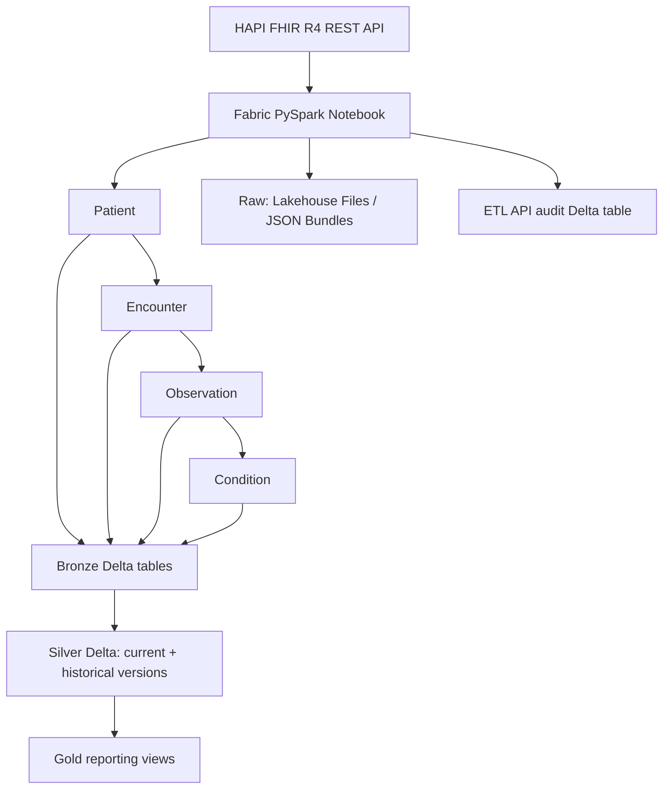

# FHIR R4 Ingestion & Medallion Architecture on Microsoft Fabric

A Microsoft Fabric data-engineering assignment demonstrating incremental ingestion from a FHIR R4 REST API, raw JSON landing, Bronze/Silver/Gold processing with Delta Lake, SCD Type 2 versioning, and run-level audit logging.

> **Implementation status:** Successfully executed in a Microsoft Fabric notebook against the public HAPI FHIR R4 test endpoint. The execution evidence and validation results below are from the Fabric runs captured on **25 November 2026**. The SCD Type 2 change test uses synthetic data in isolated test tables; it does not modify the API-derived Patient tables.

## Contents

- [Project objective](#project-objective)
- [Architecture](#architecture)
- [Technology stack](#technology-stack)
- [FHIR resources and extraction](#fhir-resources-and-extraction)
- [Medallion layers](#medallion-layers)
- [Design decisions, rationale, and validation](#design-decisions-rationale-and-validation)
- [Power BI report and semantic model](#power-bi-report-and-semantic-model)
- [SCD Type 2 strategy and test evidence](#scd-type-2-strategy-and-test-evidence)
- [Audit and observability](#audit-and-observability)
- [Fabric deployment](#fabric-deployment)
- [Validation results](#validation-results)
- [Repository structure](#repository-structure)
- [Limitations and production hardening](#limitations-and-production-hardening)

## Project objective

Build an incremental FHIR R4 ingestion and analytics pipeline in Microsoft Fabric. The pipeline retrieves four resource types in a defined order, preserves original API Bundle responses, writes resource-level Delta tables, maintains current and historical resource versions in Silver, exposes Gold reporting views, and records execution metadata in an audit table.

The configured extraction lookback is **three days (a rolling 72-hour UTC window)**. The pipeline follows the FHIR server's pagination links rather than calculating page offsets itself.

## Architecture



## Design decisions, rationale, and validation

This section explains not only what was implemented, but why the selected approach fits the assignment and what evidence was used to validate it. The choices are appropriate for this prototype and its demonstrated workload; production adoption would still require workload, security, and operational sign-off.

### 1. Why a Fabric Lakehouse and PySpark notebook?

**Decision:** Use a Microsoft Fabric Lakehouse with a PySpark notebook as the ingestion and transformation runtime.

**Why this was selected:**

- The source is a REST API returning nested FHIR JSON. Python is a natural fit for HTTP requests, pagination, retries, and JSON handling.
- Spark provides distributed DataFrame and Delta Lake capabilities for transforming and persisting resource records.
- The Lakehouse provides one Fabric-managed location for raw files and Delta tables, avoiding a separate storage and compute stack for this assignment.
- Keeping the orchestration and transformation entry point in a notebook makes the execution reproducible in the same Fabric environment where the Lakehouse data is stored.

**Why this is a reasonable fit:** The source is API/JSON-based, the assignment is implemented in Fabric, and the observed run completed all four resource types. A separate Warehouse, dbt project, or external orchestration service would add components without demonstrated need at this prototype scale. Those options can be introduced later if SQL-serving, model governance, or orchestration requirements justify them.

### 2. Why use FHIR `_lastUpdated` with a rolling three-day lookback?

**Decision:** Query the FHIR server using `_lastUpdated` with a three-day rolling window.

**Why this was selected:**

- FHIR resources expose `meta.lastUpdated`, which is the source-side timestamp relevant to detecting newly created or modified resources.
- A rolling lookback can recapture records that were temporarily missed because of a delayed run, transient API failure, or timing boundary.
- The window is bounded, so the pipeline does not need to retrieve the entire resource history on every run.
- The overlap is intentional: Bronze preserves observations from each extraction, while Silver applies version-aware processing.

**Trade-off:** A rolling window can retrieve the same resource more than once. This is why Bronze is append-oriented and why Silver must use stable resource identity plus a content hash to avoid creating a new current version for unchanged content. The three-day window is a practical assignment choice, not a universal retention or latency guarantee; production lookback duration should be agreed against the source's update latency and recovery requirements.

**Evidence:** Two executions were observed, each with a three-day (approximately 72-hour) request window. Each execution processed four resource types and fetched 32 pages. These runs demonstrate repeated rolling-window extraction, not three consecutive daily scheduled executions.

### 3. Why follow the FHIR Bundle `next` link instead of calculating page offsets?

**Decision:** Continue pagination using the `Bundle.link` entry whose relation is `next`.

**Why this was selected:**

- The FHIR server controls its pagination strategy and may return continuation URLs or tokens.
- Following the server-provided link avoids assuming that page numbers or offsets are stable.
- It reduces the risk of skipping or repeating pages when the server changes its paging implementation.

The client also uses finite request timeouts, retries transient HTTP failures, and checks that continuation links remain on the configured HTTPS host. These controls make API interaction more resilient and reduce the risk of following an unexpected pagination URL.

### 4. Why preserve the original response in Raw?

**Decision:** Save the original FHIR Bundle JSON before parsing it into tabular records.

**Why this was selected:**

- Raw is the replay and investigation layer. If a parser or downstream mapping changes, the original source response remains available.
- It separates source capture from transformation logic.
- It provides a traceable relationship between an extracted record and its source file/run metadata.

Raw is intentionally not treated as the analytics layer. Reports should consume curated Gold data, not raw API payloads.

### 5. Why use append-oriented Bronze Delta tables?

**Decision:** Store extracted resource observations in Bronze with source metadata and a SHA-256 content hash.

**Why this was selected:**

- Bronze records what was observed during ingestion, including repeated observations caused by overlapping lookback windows.
- Append-oriented ingestion preserves run-level evidence and avoids prematurely overwriting a prior source observation.
- `resource_id`, `last_updated`, `resource_hash`, `source_file`, and `ingestion_run_id` provide keys and metadata for downstream comparison and traceability.
- Delta provides a transactional table format suited to Spark-based transformations.

**Trade-off:** Bronze can contain repeated observations. That is expected for this design; downstream Silver logic is responsible for determining whether a resource is new, unchanged, or changed.

### 6. Why use a SHA-256 hash and SCD Type 2 in Silver?

**Decision:** Use the FHIR resource ID as the business identity and a content hash to detect meaningful payload changes. Maintain current and historical versions in Silver.

**Why this was selected:**

- Resource ID identifies the logical FHIR resource.
- A hash of canonicalized resource JSON gives a compact way to compare payload content without comparing every field individually.
- SCD Type 2 preserves prior values instead of overwriting them, which supports historical analysis and audit questions.
- `is_current`, `valid_from`, and `valid_to` make the version timeline explicit.
- Unchanged payloads should not create additional Silver versions when the same rolling window is reprocessed.

**How the choice was validated:** A controlled synthetic Patient with ID `P001` was ingested as `male`, re-ingested unchanged, and then changed to `female`. The final test table contained two versions: one closed historical row and one open current row. All seven assertions passed: two total versions, one current, one historical, one closed historical, one open current, zero duplicate current IDs, and two distinct hashes.

**Important scope boundary:** This proves the SCD2 transformation path with controlled synthetic input in isolated test tables. It does not prove that a changed live resource from the public HAPI endpoint was observed and versioned end to end. The live API runs showed zero duplicate current IDs, but all API-derived Silver rows were current at the time of validation.

### 7. Why create Gold reporting views?

**Decision:** Expose current-state, business-consumable views from Silver.

**Why this was selected:**

- Silver retains versioning and technical metadata; most operational reporting needs a clear current-state representation.
- Gold views provide a stable reporting interface and hide repeated filtering logic such as selecting current records.
- A dedicated Observation reporting view exposes useful analytical attributes such as patient reference, encounter reference, code, value, unit, and effective date/time.
- Views avoid maintaining a second copy of the same data for this assignment. If performance or Direct Lake requirements later require physical tables, the Gold layer can be materialized.

**Evidence:** Five Gold views were found and queried successfully in Fabric: `gold_patient`, `gold_encounter`, `gold_observation`, `gold_condition`, and `gold_observation_reporting`.

### 8. Why maintain a resource-level audit table?

**Decision:** Write one audit row per resource type per pipeline run.

**Why this was selected:**

- A single pipeline-level success flag would hide which resource call failed.
- Resource-level rows record the request window, API start/end times, save time, pages, records, status, and error message.
- A run ID ties the four resource operations together.
- The orchestrator can attempt the remaining resources, capture individual outcomes, and still fail the overall notebook run if any resource failed.

**Evidence:** Two run IDs produced eight audit rows. All four resources succeeded in each run, all eight error messages were `NULL`, and each run fetched 32 pages. This is more useful operational evidence than relying only on the notebook's green success indicator.

### 9. Why use a notebook first and leave scheduled orchestration as a later step?

**Decision:** Validate the end-to-end logic interactively in a Fabric notebook before adding a Fabric Data Pipeline schedule.

**Why this was selected:**

- It makes failures easier to isolate during development.
- Parameters such as `lookback_days`, `page_size`, and `base_url` can be tested directly.
- The notebook provides a reproducible execution artifact for review.
- Scheduling is an operational concern that should be added after the notebook, parameters, ownership, and failure behaviour are verified.

**Status:** The notebook was executed successfully twice. A daily scheduled three-day run has not been evidenced in this submission. A Fabric Data Pipeline with a Notebook activity and schedule is the next operationalisation step if the assignment expects automated daily execution.

### 10. How we judged the approach

The selected approach was not judged only by design preference. It was checked against observable outcomes:

| Design objective | Validation performed | Observed evidence |
|---|---|---|
| Retrieve all required FHIR resources | Inspect audit rows by run and resource | Four resource types per run; all eight rows `SUCCESS` |
| Handle paginated API responses | Review pages fetched per resource | 32 pages per run |
| Support a rolling three-day extraction | Inspect request-window start/end | Two runs with approximately 72-hour windows |
| Preserve resource observations | Inspect Bronze tables and metadata | Bronze resource tables populated |
| Maintain one current Silver version per resource ID | Group current rows by resource ID | Zero duplicate current IDs for all four resources |
| Preserve a changed record's history | Controlled synthetic SCD2 test | Two versions, one historical and one current |
| Expose reporting-ready data | Query Gold views | All five views available |
| Make runs auditable | Aggregate `etl_api_audit` by run ID | Two run IDs, four resources each, no audit errors |

The evidence supports the approach for this assignment prototype. It does not establish production-scale throughput, source SLA compliance, three consecutive scheduled days, or live API-to-SCD2 change capture. Those require additional tests and operational setup.

### Alternatives considered

| Concern | Selected approach | Alternative and why it was not needed for this prototype |
|---|---|---|
| API extraction | Python `requests` in Fabric | A separate integration service would add infrastructure for a small REST ingestion workload |
| Processing | PySpark in Fabric | Pure Python would be less aligned with Spark/Delta processing and Fabric execution |
| Storage | Fabric Lakehouse | A separate Warehouse is not required for raw JSON and Delta transformation storage |
| Incremental detection | FHIR `_lastUpdated` with a bounded lookback | Full extraction would repeatedly retrieve older unchanged data |
| Change detection | Resource ID + canonical content hash | Comparing every nested FHIR field manually is more complex and easier to get wrong |
| History | SCD Type 2 | Overwriting the current row would lose prior states |
| Reporting interface | Gold views | Direct reporting from Raw/Bronze would expose ingestion-level duplication and technical payloads |
| Operational evidence | Per-resource audit table | Notebook success alone does not provide resource-level counts or failure detail |

### Processing sequence

1. Generate a unique pipeline run ID and calculate the UTC extraction window.
2. Call the FHIR API for `Patient`, `Encounter`, `Observation`, and `Condition`, in that order.
3. Follow each Bundle `link` entry with `relation = next` until pagination is complete.
4. Save each original Bundle response as a JSON file in the Lakehouse Files area.
5. Extract matching resources and append resource-version rows to Bronze Delta tables.
6. Apply Silver transformations and SCD Type 2 processing.
7. Create/refresh Gold views for current records.
8. Write one audit record per resource type, including timestamps, page/record counts, status, and error details.

## Technology stack

- Microsoft Fabric Lakehouse and Spark notebook
- PySpark / Spark SQL
- Delta Lake (`delta.tables.DeltaTable`)
- Python 3.10+
- `requests` and `urllib3` for HTTP access and retry handling
- Git and GitHub for source control

## FHIR resources and extraction

| Order | FHIR resource | Bronze table | Silver table |
|---:|---|---|---|
| 1 | Patient | `bronze_fhir_patient` | `silver_fhir_patient` |
| 2 | Encounter | `bronze_fhir_encounter` | `silver_fhir_encounter` |
| 3 | Observation | `bronze_fhir_observation` | `silver_fhir_observation` |
| 4 | Condition | `bronze_fhir_condition` | `silver_fhir_condition` |

Default endpoint: `https://hapi.fhir.org/baseR4`

Default parameters:

```python
lookback_days = 3
page_size = 100
base_url = "https://hapi.fhir.org/baseR4"
```

The API search uses `_lastUpdated` with a lower and upper bound for the rolling three-day window. The server-provided `next` URL is followed for pagination. The client applies finite request timeouts, retries transient HTTP failures, and checks that pagination links remain on the configured HTTPS host.

## Medallion layers

### Raw

Original FHIR Bundle JSON is stored in Lakehouse Files, partitioned by resource, extraction date, and run ID. Raw payloads are preserved before parsing so that the source response can be inspected independently of downstream transformations.

Example path pattern:

```text
Files/raw/fhir/<Resource>/YYYY/MM/DD/run_id=<run-id>/page_00001.json
```

### Bronze

Append-oriented Delta tables contain one row per extracted resource observation/version. The resource JSON is retained as canonicalized JSON, with metadata including:

- `resource_type`
- `resource_id`
- `last_updated`
- `resource_json`
- `resource_hash` (SHA-256)
- `extraction_timestamp`
- `api_url_or_params`
- `source_file`
- `ingestion_run_id`

Overlapping incremental windows can result in repeated observations in Bronze. Silver is responsible for resolving the latest resource version and maintaining current/history state.

### Silver

Silver tables retain the full `resource_json` and expose common queryable attributes such as status, patient/subject reference, encounter reference, effective date/time, resource hash, and SCD2 validity columns.

SCD2 columns include:

- `is_current`
- `valid_from`
- `valid_to`
- `created_at`
- `updated_at`

When an incoming resource has the same ID but a changed hash, the prior current version is closed and a new current version is inserted. An unchanged resource should not create an additional Silver version.

### Gold

The following current-state views were created and validated:

- `gold_patient`
- `gold_encounter`
- `gold_observation`
- `gold_condition`
- `gold_observation_reporting`

The views expose current resource records for downstream reporting. The reporting view provides Observation-focused fields such as patient reference, encounter reference, code text, value, unit, and effective date/time.

## Power BI report and semantic model

**Purpose:** Use the Gold layer as the reporting contract for a Power BI report. Power BI should consume curated, current-state data rather than querying Raw JSON or append-oriented Bronze tables directly.

### Recommended data source

Use the Gold reporting objects as the source for the Power BI semantic model:

- `gold_patient`
- `gold_encounter`
- `gold_observation`
- `gold_condition`
- `gold_observation_reporting`

The Observation reporting view is the natural starting point for clinical-observation analysis. Patient, Encounter, and Condition views can provide additional context and cross-resource reporting where the relationships and keys are available.

### Why this reporting approach?

- **Separation of responsibilities:** Fabric handles API ingestion, history, and transformation; Power BI handles semantic modelling, measures, and visual exploration.
- **Consistent business definitions:** Gold views centralise the current-record filter and selected reporting attributes so that each report visual does not independently reimplement ingestion or SCD2 logic.
- **Safer consumption:** Report authors do not need to parse nested FHIR JSON or work directly with repeated Bronze observations.
- **Maintainability:** Changes to extraction and parsing can be isolated from the report when the Gold contract remains stable.

### Suggested report pages and visuals

Use these as a report design checklist. Keep only visuals that are actually present in the submitted PBIX/report.

| Page | Suggested content | Suggested visual |
|---|---|---|
| Executive overview | Current Patients, Encounters, Observations, Conditions | KPI cards |
| Resource overview | Record counts by FHIR resource type | Clustered bar/column chart |
| Observation analysis | Observation counts by code, value/unit, and effective date | Bar chart, trend line, detail table |
| Patient / Encounter context | Patient and Encounter relationships where keys support them | Table or drill-through |
| Pipeline monitoring | Run status, records fetched, pages fetched, run timestamps, extraction window | Audit table, KPI cards, run trend |
| Data quality | Missing IDs/timestamps, duplicate current IDs, failed resource runs where measures are built | KPI cards and exception table |

### Suggested Power BI measures

Create measures against the actual semantic-model table names and confirm the relationships before using them. Examples below assume the model exposes the named Gold tables.

```DAX
Patient Count =
DISTINCTCOUNT ( gold_patient[resource_id] )

Encounter Count =
DISTINCTCOUNT ( gold_encounter[resource_id] )

Observation Count =
DISTINCTCOUNT ( gold_observation[resource_id] )

Condition Count =
DISTINCTCOUNT ( gold_condition[resource_id] )
```

For audit monitoring, measures should be created from `etl_api_audit` only if that table is intentionally included in the semantic model. For example:

```DAX
Successful Resource Runs =
CALCULATE (
    COUNTROWS ( etl_api_audit ),
    etl_api_audit[status] = "SUCCESS"
)
```

### Power BI validation checklist

Before marking the report complete, validate:

1. The semantic model connects to the intended Gold objects in the correct Fabric workspace/Lakehouse.
2. Relationships use the correct FHIR reference keys; do not assume that a Patient ID and a FHIR reference string are identical without checking their format.
3. KPI cards reconcile to the corresponding Gold view counts in Fabric.
4. Date filters use the intended clinical date or ingestion date, and the distinction is labelled clearly.
5. The report does not expose Raw JSON, unnecessary identifiers, or sensitive patient-level details.
6. Refresh or Direct Lake behaviour is tested in the target workspace and documented.
7. Screenshots of each report page and the semantic model are saved under `evidence/powerbi/`.

**Implementation evidence note:** The Fabric execution evidence in this README validates the five Gold views, but it does not by itself prove that a Power BI report has been built, connected, refreshed, or reconciled. Add the actual report name, workspace, connection mode, page names, screenshots, and reconciliation results after verifying them in Power BI. Do not mark this section as completed based only on Gold-view validation.

## SCD Type 2 strategy and test evidence

SCD Type 2 behaviour was tested in isolated Delta tables using a synthetic Patient resource with ID `P001`. The test deliberately used the same resource ID and changed the resource content from `gender = male` to `gender = female`.

Test table names:

```text
scd2_test_bronze_patient
scd2_test_silver_patient
```

Test sequence:

1. Insert the initial synthetic Patient version (`male`).
2. Re-ingest the same unchanged resource to test idempotency.
3. Ingest the same resource ID with changed content (`female`).
4. Assert the historical and current version state.

**Observed final validation output:**

| Assertion | Observed result |
|---|---:|
| Total versions | 2 |
| Current versions | 1 |
| Historical versions | 1 |
| Closed historical versions | 1 |
| Open current versions | 1 |
| Duplicate current records | 0 |
| Distinct resource hashes | 2 |

All seven SCD2 assertions passed in the Fabric notebook.

**Scope clarification:** This proves the SCD2 transformation path using controlled synthetic input. The public API extraction runs did not demonstrate an actual changed live FHIR resource transitioning through SCD2. The synthetic test tables are separate from the API-derived Silver tables.

## Audit and observability

The Delta audit table is `etl_api_audit`. It records one row per resource per pipeline run, including:

- `ingestion_run_id`
- `resource_type`
- `api_call_started_at`
- `api_call_completed_at`
- `data_saved_at`
- `request_window_start`
- `request_window_end`
- `pages_fetched`
- `records_fetched`
- `status`
- `error_message`

Resource-level failures are logged and audited. The orchestrator continues with the remaining configured resource types, then raises a pipeline-level exception if any resource failed so that the Fabric notebook activity is marked as failed.

## Fabric deployment

### Prerequisites

- A Microsoft Fabric workspace with permission to create and run Lakehouses and notebooks.
- Fabric capacity or trial capacity that supports Spark execution.
- A Lakehouse attached to the notebook as its default Lakehouse.
- Access to the public HAPI FHIR endpoint from the Fabric environment.

### 1. Create and attach the Lakehouse

Create a Lakehouse named `FHIR_Lakehouse` in the target workspace. Attach it to the notebook as the default Lakehouse.

### 2. Upload the Python package

Upload the contents of `src/fhir_fabric/` to this Lakehouse location:

```text
Files/code/fhir_fabric/
```

The expected package files are:

```text
__init__.py
config.py
fhir_client.py
logging_utils.py
orchestrator.py
raw_storage.py
record_parser.py
spark_pipeline.py
```

The notebook adds `/lakehouse/default/Files/code` to `sys.path` before importing the package.

### 3. Create the notebook

Create a Fabric notebook named `NB_FHIR_Medallion_Pipeline`, attach `FHIR_Lakehouse`, and add a parameter cell:

```python
lookback_days = 3
page_size = 100
base_url = "https://hapi.fhir.org/baseR4"
```

Add the pipeline execution cell from `notebooks/01_fhir_medallion_pipeline.ipynb` (or the `.py` notebook source). Execute the parameter cell and then the pipeline cell.

### 4. Validate the Lakehouse

Confirm the Raw JSON files exist and that the Bronze, Silver, Gold, and audit tables/views listed above are present. Example audit query:

```python
display(spark.sql("""
    SELECT
        ingestion_run_id,
        resource_type,
        request_window_start,
        request_window_end,
        pages_fetched,
        records_fetched,
        status,
        error_message
    FROM etl_api_audit
    ORDER BY api_call_started_at DESC
"""))
```

### 5. Schedule through a Fabric Data Pipeline (optional)

Create a Fabric Data Pipeline with a Notebook activity that invokes `NB_FHIR_Medallion_Pipeline`. Pass `lookback_days=3`, `page_size=100`, and the configured FHIR base URL as notebook parameters. Configure a daily schedule only after confirming workspace capacity, ownership, and operational requirements.

## Validation results

The following results were observed in the Fabric notebook on 25 November 2026.

### Three-day extraction runs

Two successful pipeline executions were recorded. Each execution covered a rolling 72-hour window and processed all four resource types. Each run fetched 32 API pages.

| Resource | Run 1 records | Run 2 records | Pages per run |
|---|---:|---:|---:|
| Patient | 1,618 | 1,618 | 17 |
| Encounter | 581 | 581 | 6 |
| Observation | 638 | 636 | 7 |
| Condition | 182 | 181 | 2 |
| **Total** | **3,019** | **3,016** | **32** |

Audit validation showed **8 resource audit rows**, with **4 resources processed per run**, **4 successful resources per run**, and `error_message = NULL` for all eight rows.

The counts differ slightly between runs for Observation and Condition. The endpoint is a shared public test server and its data can change between calls; this is not evidence of a pipeline failure.

**Three-day requirement clarification:** The evidence demonstrates two executions, each using a three-day rolling lookback window. It does not demonstrate three consecutive daily scheduled executions.

### Silver validation

The observed current-record counts were:

| Silver table | Current records |
|---|---:|
| `silver_fhir_patient` | 1,618 |
| `silver_fhir_encounter` | 581 |
| `silver_fhir_observation` | 638 |
| `silver_fhir_condition` | 182 |
| **Total** | **3,019** |

Duplicate-current-ID checks returned zero for all four resource types.

### Gold validation

| Gold view | Records | Result |
|---|---:|---|
| `gold_patient` | 1,618 | Available |
| `gold_encounter` | 581 | Available |
| `gold_observation` | 638 | Available |
| `gold_condition` | 182 | Available |
| `gold_observation_reporting` | 638 | Available |

### Evidence screenshots

Add your actual Fabric screenshots to an `evidence/` folder in this repository and use the following names. Do not commit real patient data or credentials.

```text
evidence/
  01_fabric_notebook_success.png
  02_audit_three_day_extraction.png
  03_audit_success_statuses.png
  04_silver_current_counts.png
  05_duplicate_current_checks.png
  06_gold_view_validation.png
  07_scd2_two_versions.png
  08_scd2_validation_passed.png
  powerbi/
    01_report_overview.png
    02_observation_analysis.png
    03_pipeline_monitoring.png
    04_semantic_model.png
```

## Repository structure

```text
.
├── config/
│   └── config.example.json
├── notebooks/
│   ├── 01_fhir_medallion_pipeline.ipynb
│   └── 01_fhir_medallion_pipeline.py
├── src/
│   └── fhir_fabric/
│       ├── __init__.py
│       ├── config.py
│       ├── fhir_client.py
│       ├── logging_utils.py
│       ├── orchestrator.py
│       ├── raw_storage.py
│       ├── record_parser.py
│       └── spark_pipeline.py
├── sql/
│   └── 01_gold_views.sql
├── tests/
│   ├── test_config.py
│   └── test_fhir_client.py
├── requirements.txt
├── pyproject.toml
└── README.md
```

## Local development and tests

The complete ingestion and Delta pipeline requires the Fabric Spark runtime and Fabric `notebookutils`. Pure Python unit tests can be run locally:

```bash
python -m venv .venv
# Windows PowerShell: .venv\Scripts\Activate.ps1
# macOS/Linux: source .venv/bin/activate
pip install -r requirements.txt pytest
PYTHONPATH=src pytest -q
```

Fabric provides the Spark and Delta runtime; do not independently pin a local Spark version and assume it exactly matches the Fabric runtime.

## Limitations and production hardening

- The public HAPI endpoint is a shared test server, not a production healthcare data source. Production use requires an approved FHIR endpoint, authentication, network controls, and operational support.
- No real patient data, credentials, or secrets should be committed to GitHub. Treat all healthcare data as sensitive and apply the organisation's privacy, access, retention, and audit requirements.
- The current SCD2 update path was verified with synthetic input in isolated test tables. A further integration test against a controlled FHIR test resource would be needed to prove live API-to-Silver historical updates end to end.
- The implementation uses FHIR JSON. XML ingestion is not included.
- Gold objects are Spark SQL views. Schema-enabled Lakehouse deployments may require catalog/schema-qualified names and corresponding adjustments to the SQL.
- For production scale, add durable page-level checkpoints/recovery, source throttling aligned with the FHIR server's policy, alerting, retention controls, and workload-specific performance tests.
- Review the SCD2 merge metrics and operational counters against the actual inserted/closed row counts before using them for production SLAs.

## Submission summary

This assignment demonstrates a working Fabric FHIR ingestion pipeline, a three-day rolling extraction window, Raw/Bronze/Silver/Gold layers, resource-level audit logging, duplicate-current checks, and a controlled SCD Type 2 historical-version test. Execution metrics and test scope are documented above so that reviewers can distinguish observed results from additional production-hardening work.
